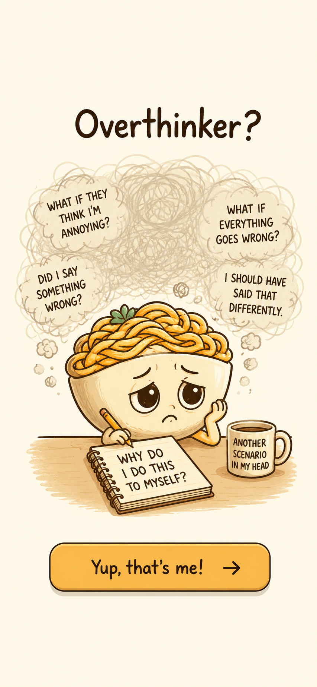
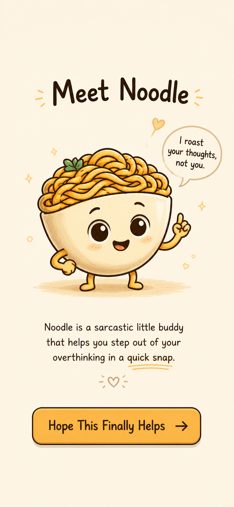
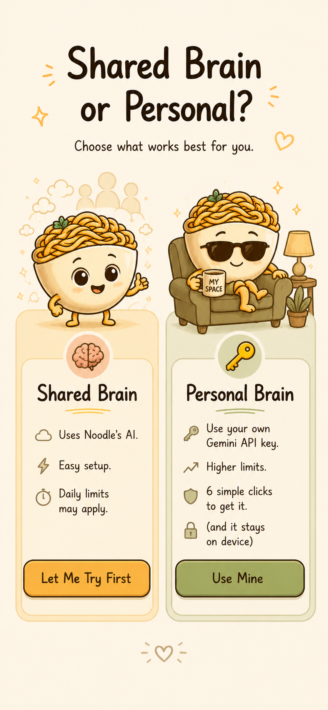

# 🍜 Noodle

> A sarcastic voice companion that helps you stop overthinking, one emotional dump at a time.

🌐 **Landing Page:** [maitry4.github.io/Noodle](https://maitry4.github.io/Noodle/)

📱 **Download APK:** [Gumroad](https://maitry8.gumroad.com/l/noodle)

Noodle is a privacy-first AI voice companion for people who get stuck in loops of self-doubt, over-analysis, and overthinking. You speak your thoughts, and Noodle responds with playful sarcasm and a nudge to move on — then forgets everything.

No journaling. No emotional archives. No conversation history. Just vent, laugh, and continue your day.

---

## 📸 Screenshots

### Onboarding Experience

| Screen 1 | Screen 2 |
|----------|----------|
|  |  |

| Screen 3 | Screen 4 |
|----------|----------|
|  |  |

---

## ✨ How It Works

```text
Select Language (EN / IN / हि)
         ↓
    Tap "Dump It"
         ↓
  Speak your thoughts
  (streamed as raw PCM audio over WebSocket)
         ↓
  Tap "Stop" (or auto-stop at 60s)
         ↓
  Audio → Gemini 2.5 Flash Native Audio
         ↓
  Sarcastic audio response streams back
  (played in real-time as PCM)
         ↓
  Everything is forgotten
```

The entire interaction is **voice-in, voice-out** — no text transcription step is exposed to the user. The client streams raw 16 kHz mono PCM audio to the backend over a WebSocket, the backend pipes it into Gemini's live audio session, and Gemini's audio response (24 kHz PCM) streams back to the client for immediate playback.

---

## 🎯 Core Principles

### Privacy First

Noodle never stores your emotional dumps. Audio data exists only during the active WebSocket session — it is streamed directly to Gemini, and nothing is persisted on the server.

### Stateless & Lightweight

No chat threads. No message history. No conversation management. Each interaction is a single fire-and-forget WebSocket session.

### Friendly Sarcasm

Noodle isn't a therapist or a life coach. It's a slightly chaotic friend with language-specific personality prompts that playfully roast your spiraling thoughts while staying warm underneath.

---

## 🗣 Supported Languages

Noodle supports three language modes, selectable from the main screen:

| Code | Label | Behavior |
|------|-------|----------|
| `en-US` | EN | Standard US English responses |
| `en-IN` | IN | Indian English with natural Hinglish flavor (yaar, arre, chill na) |
| `hi-IN` | हि | Pure Hindi responses |

Each language has a dedicated system prompt that shapes Noodle's personality and response style.

---

## 🏗 Architecture

### System Overview

```text
┌──────────────────────┐        WebSocket (wss://)         ┌──────────────────────┐
│   Flutter Mobile App  │ ◄──── PCM audio streaming ────► │  FastAPI Backend      │
│                       │       + "END" signal             │  (Hugging Face Space) │
│  • Records mic audio  │       + "__AUDIO_END__" marker   │                       │
│    (16kHz, mono, PCM) │                                  │  • Rate limiting      │
│  • Streams to server  │                                  │    (SQLite)           │
│  • Plays back response│                                  │  • Gemini Live Audio  │
│    (24kHz PCM)        │                                  │    session proxy      │
│  • Hive + SecureStore │                                  │  • Stats tracking     │
└──────────────────────┘                                   └──────────────────────┘
                                                                     │
                                                                     ▼
                                                           ┌──────────────────────┐
                                                           │  Gemini 2.5 Flash    │
                                                           │  Native Audio        │
                                                           │  (Live API)          │
                                                           └──────────────────────┘
```

### Repository Structure

```text
Noodle/
├── noodle/                        # Flutter app + Python backend
│   ├── lib/
│   │   ├── main.dart              # App entry point (Hive init, ProviderScope)
│   │   ├── core/
│   │   │   ├── models/            # AppSettings, UserSettings
│   │   │   ├── providers/         # Riverpod providers (Hive, SecureStorage)
│   │   │   ├── routers/           # GoRouter config with onboarding guard
│   │   │   ├── services/          # AudioService, WebSocketService,
│   │   │   │                      # DeviceUuidService, HiveService,
│   │   │   │                      # SecureStorageService
│   │   │   ├── theme/             # AppColors, AppTheme
│   │   │   └── widgets/           # NoodleButton, NoodleTextField,
│   │   │                          # TransparentButton
│   │   └── features/
│   │       ├── brain/             # Main interaction screen
│   │       │   ├── data/          #   RespondUser (ChangeNotifier controller)
│   │       │   └── presentation/  #   FloatingCharacter, NoodleCharacter,
│   │       │                      #   DumpButton, SteamLayer, overlays
│   │       ├── onboarding/        # 4-screen onboarding flow + API key entry
│   │       │   ├── data/          #   OnboardingData (save preferences)
│   │       │   └── presentation/  #   OnboardingScreen1-4, SaveUserApi
│   │       └── settings/          # Settings management
│   │           ├── data/          #   SettingsController
│   │           └── presentation/  #   SaveUserSettings (brain toggle + API key)
│   ├── assets/                    # Character images (webp) for each state
│   ├── android/                   # Android platform config
│   └── server/                    # Python backend
│       ├── main.py                # FastAPI app, WebSocket endpoint, stats endpoint
│       ├── services/
│       │   ├── noodle_websocket_service.py  # Gemini Live Audio session management
│       │   ├── rate_limiter.py              # Per-device rate limiting (20/day)
│       │   ├── stats_service.py             # Rant-resolved counter
│       │   └── db.py                        # SQLite init (stats + rate_limits tables)
│       ├── data/noodle.db         # SQLite database
│       ├── Dockerfile             # Python 3.13 slim, port 7860
│       ├── requirements.txt       # fastapi, uvicorn, google-genai, etc.
│       └── load_test.py           # WebSocket load testing script
│
├── landing_page/                  # Next.js 16 landing page
│   ├── src/app/
│   │   ├── page.tsx               # Home page (video bg, download link, live stats)
│   │   └── layout.tsx             # Root layout
│   ├── next.config.ts             # Static export, basePath: /Noodle
│   └── package.json               # React 19, Tailwind CSS 4
│
├── .github/workflows/
│   ├── build-apk.yml              # Build signed APK (trigger: "deploy:app")
│   ├── deploy-backend.yml         # Sync to Hugging Face Space (trigger: "deploy:backend")
│   └── deploy-landing.yml         # Build & deploy to GitHub Pages (trigger: "deploy:landing")
│
├── UI_Designs/                    # Onboarding screenshot PNGs
└── README.md
```

---

## 📱 Frontend (Flutter)

### Tech Stack

| Technology | Purpose |
|---|---|
| Flutter (Dart SDK ^3.10) | Cross-platform UI framework |
| Riverpod | State management & dependency injection |
| GoRouter | Declarative routing with onboarding redirect guard |
| Hive | Local key-value storage (onboarding status, brain mode) |
| flutter_secure_storage | Encrypted storage for user's Gemini API key |
| record | Microphone audio capture (PCM 16-bit, 16kHz, mono) |
| flutter_pcm_sound | Low-latency PCM audio playback (24kHz, mono) |
| shared_preferences | Persistent device UUID |
| uuid | UUID v4 generation |
| http / http_parser | HTTP utilities |

### Key Features

- **4-screen onboarding flow** with image-based screens and transparent tap targets
- **Animated Noodle character** with floating animation, pulsing glow, and state-specific images (listening, thinking, speaking)
- **Real-time audio streaming** — mic audio streamed over WebSocket as raw PCM chunks
- **Real-time audio playback** — Gemini's response audio played back as it arrives (no waiting for full response)
- **Steam particle animation** during playback
- **Language switcher** (EN / IN / हि) on the main screen
- **Bring Your Own Key** — users can provide their own Gemini API key, stored in encrypted secure storage
- **Shared Brain mode** — uses the server's shared API key with rate limiting
- **Settings screen** — toggle between Shared Brain / My Brain, manage API key

### App States

The main screen (`FloatingCharacter`) cycles through these states:

| State | Character Image | UI |
|---|---|---|
| Idle | `noodle_listening.webp` | "what's eating you?" + Dump It button |
| Recording | `noodle_listening.webp` | "Dumping..." + Stop button (red) |
| Processing | `noodle_thinking.webp` | "Wait a minute..." + bouncing dots |
| Playing | `noodle_speaking.webp` | "Speaking..." + steam particles |
| Error | (unchanged) | Red error banner with dismiss |

---

## ⚙️ Backend (FastAPI)

### Tech Stack

| Technology | Purpose |
|---|---|
| FastAPI | Async web framework |
| uvicorn | ASGI server |
| google-genai | Gemini API client (Live Audio sessions) |
| SQLite | Rate limiting & stats persistence |
| Python 3.13 | Runtime (matches Docker image) |

### Endpoints

| Endpoint | Type | Description |
|---|---|---|
| `/ws/noodle` | WebSocket | Main voice interaction session |
| `/stats` | GET (REST) | Returns `{ "rant_resolved": N }` — powers the landing page counter |

### WebSocket Flow (`/ws/noodle`)

1. **Client connects** with query params `device_uuid` and `language_code`, optional header `x-api-key`
2. **API key resolution**: if `x-api-key` header is present, use it directly; otherwise check rate limit for the device UUID and use the shared server key
3. **Rate limiting**: 20 requests per device per 24-hour sliding window (SQLite-backed). Users with their own API key bypass rate limiting entirely
4. **Gemini session**: opens a `gemini-2.5-flash-native-audio-latest` Live session with `AUDIO` response modality and a language-specific system prompt
5. **Audio streaming**: client sends raw PCM bytes → server forwards to Gemini via `send_realtime_input`. Client sends `"END"` text message to signal recording is done
6. **Response streaming**: Gemini's audio chunks are forwarded back to the client as binary WebSocket frames in real-time
7. **Completion**: server sends `"__AUDIO_END__"` text marker, increments the rant-resolved counter, and the connection closes
8. **Timeouts**: 40s idle timeout for client audio, 40s timeout for Gemini's first response chunk, 40s between subsequent chunks

### Database Schema (SQLite)

```sql
-- Stats counter (singleton row)
CREATE TABLE stats (
    id INTEGER PRIMARY KEY CHECK (id = 1),
    rant_resolved INTEGER DEFAULT 28
);

-- Per-device rate limiting
CREATE TABLE rate_limits (
    device_uuid TEXT PRIMARY KEY,
    count INTEGER DEFAULT 1,
    first_request_ts REAL
);
```

### CORS & Origin Policy

- REST `/stats` endpoint: CORS allows `https://maitry4.github.io` with `GET` only
- WebSocket `/ws/noodle`: origin check rejects connections not from `https://maitry4.github.io` (mobile app connections have no origin header, so they pass through)

---

## 🌐 Landing Page (Next.js)

A single-page static site built with **Next.js 16**, **React 19**, and **Tailwind CSS 4**.

- Looping background video
- Noodle character image
- Download link to Gumroad
- **Live "rants resolved" counter** — fetches from the backend `/stats` endpoint on page load
- Feedback form link (Google Forms)
- Statically exported (`output: "export"`) and deployed to GitHub Pages at `/Noodle/`

---

## 🚀 Deployment

### CI/CD Pipelines (GitHub Actions)

All deployments are triggered by commit message keywords or manual `workflow_dispatch`:

| Pipeline | Trigger | Target |
|---|---|---|
| `build-apk.yml` | Commit message contains `deploy:app` | Builds signed release APK → uploaded as GitHub Actions artifact |
| `deploy-backend.yml` | Commit message contains `deploy:backend` + changes in `noodle/server/` | Syncs server files to Hugging Face Space via git push |
| `deploy-landing.yml` | Commit message contains `deploy:landing` + changes in `landing_page/` | Builds Next.js static export → deploys to GitHub Pages |

### Infrastructure

```text
┌─────────────────┐     ┌──────────────────────────┐     ┌──────────────────┐
│  GitHub Pages   │     │  Hugging Face Spaces      │     │  Gumroad         │
│  (Landing Page) │     │  (Docker, port 7860)      │     │  (APK download)  │
│                 │     │  maitry4-noodle-backend    │     │                  │
└─────────────────┘     └──────────────────────────┘     └──────────────────┘
```

> **Note:** Since the APK is distributed outside the Google Play Store, users need to enable **"Install from unknown sources"** on their Android device. Android may also show a Play Protect warning — this is expected for sideloaded apps.

---

## 🚀 Getting Started (Local Development)

### Prerequisites

* Flutter SDK (^3.10)
* Python 3.13+ (matches the deployed Docker image)
* Node.js 20+ (for the landing page)
* A Gemini API key with access to the Live Audio API
* Docker (optional, for running the backend the same way it's deployed)

### Backend Setup

**Option A — Local (no Docker)**

1. Navigate to the server directory: `cd noodle/server`
2. Create and activate a virtual environment:
   ```bash
   python -m venv .venv
   source .venv/bin/activate  # or .venv\Scripts\activate on Windows
   ```
3. Install dependencies: `pip install -r requirements.txt`
4. Create a `.env` file with your API key:
   ```env
   API_KEY=your_gemini_api_key_here
   ```
5. Run the development server: `uvicorn main:app --reload`

**Option B — Docker (matches production)**

1. Navigate to the server directory: `cd noodle/server`
2. Build the image:
   ```bash
   docker build -t noodle-backend .
   ```
3. Run the container:
   ```bash
   docker run -p 7860:7860 --env-file .env noodle-backend
   ```
4. The API will be available at `http://localhost:7860`

### Frontend Setup

1. Navigate to the app directory: `cd noodle`
2. Fetch dependencies: `flutter pub get`
3. Run the app: `flutter run`

> **Note:** The app connects to the production backend at `wss://maitry4-noodle-backend.hf.space/ws/noodle` by default. To point at a local backend, update the host in `lib/core/services/websocket_service.dart`.

### Landing Page Setup

1. Navigate to: `cd landing_page`
2. Install dependencies: `pnpm install` (or `npm install`)
3. Run dev server: `pnpm dev`

### Load Testing

A WebSocket load test script is included:

```bash
cd noodle/server
python load_test.py --users 10 --url wss://maitry4-noodle-backend.hf.space/ws/noodle
```

It sends the bundled `Hello_Noodle.pcm` audio file to simulate concurrent users and reports TTFB and total duration metrics.

---

## 🔒 Privacy Model

### Stored Locally (on device)

| Data | Storage | Purpose |
|---|---|---|
| Onboarding status | Hive | Skip onboarding on subsequent launches |
| Brain mode (Shared/Own) | Hive | Determine which API key to use |
| Gemini API key | flutter_secure_storage (encrypted) | BYOK authentication |
| Device UUID | SharedPreferences | Rate limiting identifier |

### Temporarily Processed (never stored)

* Voice audio — streamed over the WebSocket, never saved to disk on the server
* Gemini audio response — streamed back and discarded

### Never Stored

* Conversation history
* Emotional content / rant text
* User profiles
* Long-term memories

Noodle is intentionally designed without persistent memory.

---

## 🧠 Bring Your Own Key (BYOK)

Users may provide their own Gemini API key in settings or during onboarding.

**Benefits:**
- Bypasses the server's rate limit entirely (no 20/day cap)
- Reduced dependency on shared infrastructure
- Faster access during high traffic periods

The key is stored in the device's encrypted secure storage and sent via the `x-api-key` WebSocket header — it never touches the server's filesystem.

Users can also use the shared Noodle key (subject to 20 requests/day per device), selectable from Settings.

---

## ❌ What Noodle Is Not

- A therapist
- A mental health diagnosis tool
- A journaling platform
- A productivity coach
- A memory assistant

---

## 📄 License

This project is licensed under the [MIT License](LICENSE).
